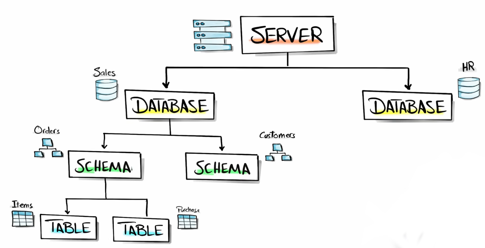
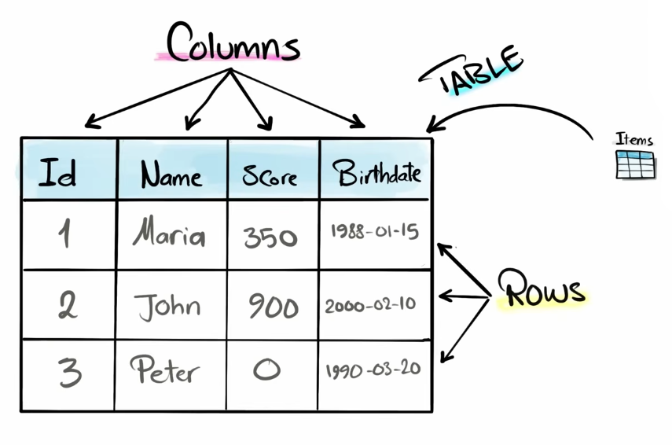
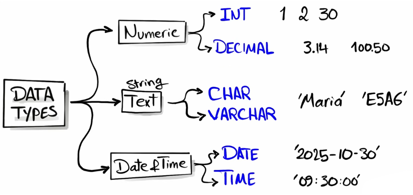

> [!attention] Note
> These are my notes and interpretation. Consider to watch the videos[^1] as the source of information.

[^1]: [SQL Full Course for Beginners (30 Hours) – From Zero to Hero](https://youtu.be/SSKVgrwhzus?si=uuB_Lyjd6XhPqkCF), [@DataWithBaraa](https://www.youtube.com/@DataWithBaraa)

[git](https://github.com/DataWithBaraa/sql-ultimate-course)

## What is SQL?

Everything is [Data](https://en.wikipedia.org/wiki/Data) and they are stored in [Database](https://en.wikipedia.org/wiki/Database). [SQL](https://en.wikipedia.org/wiki/SQL)(**S**tructured **Q**uery **L**anguage) is the language used to comunicate with [Database](https://en.wikipedia.org/wiki/Database).

The [SQL](https://en.wikipedia.org/wiki/SQL) connects to a [DBMS](https://en.wikipedia.org/wiki/Database#Database_management_system)(**D**ata**B**ase **M**anagement **S**ystem) which is, as Connolly and Begg[^2] defines it, a "software system that enables users to define, create, maintain and control access to the database".

[^2]: Connolly & Begg 2014, p. 64.

In order to make the database available to everyone everytime (24/7), it must be running on a computer running all the time.
And that's when comes the [Server](https://en.wikipedia.org/wiki/Server_(computing)).

## Database types

| SQL Database | NonSQL Database |
| --- | --- |
| Relational database | Key-value |
| | Column-based |
| | Graph Database |
| | Document Database |

[Relational Database](https://en.wikipedia.org/wiki/Relational_database), basicaly, are a collection of [schema](https://en.wikipedia.org/wiki/Database_schema)s and these are a strutures of [table](https://en.wikipedia.org/wiki/Table_(database))s that comunicate to each other.

[^1]

[Table](https://en.wikipedia.org/wiki/Table_(database))s are composed of [row](https://en.wikipedia.org/wiki/Row_(database))s and [column](https://en.wikipedia.org/wiki/Column_(database))s. In a [Relational Database](https://en.wikipedia.org/wiki/Relational_database), normaly, the first [column](https://en.wikipedia.org/wiki/Column_(database)) (`Id`) is the [Primary Key](https://en.wikipedia.org/wiki/Primary_key) that identify and distinguish between each individual record([row](https://en.wikipedia.org/wiki/Row_(database))s) in a table. 

[^1]

On each [column](https://en.wikipedia.org/wiki/Column_(database)) stores a especific [Data Type](https://en.wikipedia.org/wiki/SQL#SQL_data_types).

[^1]

The [Data Type](https://en.wikipedia.org/wiki/Data_type) in [SQL](https://en.wikipedia.org/wiki/SQL) can be:

* [Interger](https://en.wikipedia.org/wiki/Integer_(computer_science))
* [Decimal](https://en.wikipedia.org/wiki/Decimal_floating_point)
* [Text](https://en.wikipedia.org/wiki/String_(computer_science))
* [Date & Time](https://en.wikipedia.org/wiki/Integer_(computer_science))

## SQL Commands

